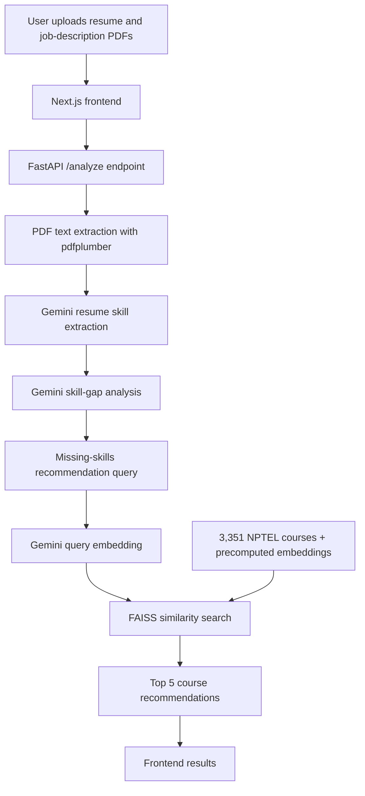

# AI-Driven Skill Gap Analysis

**An AI-based system for analyzing a resume against a job description and recommending relevant NPTEL courses.**

[**Live Demo**](https://ai-skill-gap-analysis.vercel.app) · [**Backend API**](https://ai-skill-gap-analysis-production.up.railway.app) · [**Source Code**](https://github.com/himnad/AI-Skill-Gap-Analysis)

## Overview

AI-Driven Skill Gap Analysis is a full-stack web application that compares a candidate's resume with a job description, identifies the skills the candidate lacks, and recommends relevant courses from a catalog of **3,351 NPTEL courses**.

The system combines **Gemini-based skill extraction and gap analysis** with **embedding-based semantic retrieval** using FAISS.

## Key Features

- **Document upload:** Accepts a resume and a job description in PDF format through the web interface.
- **Resume skill extraction:** Employs Gemini to identify the skills stated in the resume.
- **Skill-gap identification:** Compares the extracted skills against the requirements of the job description.
- **Semantic course matching:** Retrieves relevant NPTEL courses using Gemini embeddings and FAISS.
- **Top-five recommendations:** Presents course names, disciplines, instructors, institutes, links, and similarity scores.
- **Production deployment:** The Next.js frontend is hosted on Vercel and the FastAPI backend on Railway.

## Live Application

- **Frontend:** https://ai-skill-gap-analysis.vercel.app
- **Backend:** https://ai-skill-gap-analysis-production.up.railway.app

### Usage

1. Open the [live application](https://ai-skill-gap-analysis.vercel.app).
2. Upload the resume as a PDF file.
3. Upload the job description as a PDF file.
4. Initiate the analysis.
5. Review the extracted resume skills, the identified missing skills, and the recommended NPTEL courses.

## System Architecture



The frontend and backend are deployed independently. The backend is responsible for document processing, AI-based analysis, and course retrieval.

## Technology Stack

| Layer | Technologies |
|---|---|
| Frontend | Next.js 16, React 19, TypeScript, Tailwind CSS |
| Backend | Python, FastAPI, Uvicorn |
| PDF processing | pdfplumber |
| AI analysis | Gemini `gemini-2.5-flash` |
| Embeddings | Gemini `gemini-embedding-001` |
| Semantic search | FAISS (`IndexFlatIP`), NumPy |
| Course data | Pandas, CSV, NumPy embeddings |
| Deployment | Vercel (frontend), Railway (backend) |

## Recommendation Pipeline

1. The backend extracts text from the uploaded PDF files using **pdfplumber**.
2. **Gemini 2.5 Flash** extracts the resume skills and identifies the skills that are missing relative to the job description.
3. The missing skills are combined into a single semantic search query.
4. **`gemini-embedding-001`** converts the query into an embedding vector.
5. FAISS searches the precomputed NPTEL course index.
6. The system returns the **five most relevant courses**.

The catalog's **3,072-dimensional embeddings** are normalized and indexed using FAISS **`IndexFlatIP`**. For normalized vectors, inner-product similarity is equivalent to cosine similarity.

## NPTEL Course Dataset

The course catalog comprises **3,351 courses**, each described by the following metadata fields:

| Field | Description |
|---|---|
| `Discipline` | Discipline or domain of the course |
| `Course_Name` | Title of the NPTEL course |
| `Instructor_Name` | Name of the instructor |
| `Institute_Name` | Offering institution |
| `Course_URL` | Link to the course |

The data assets are located at:

```text
backend/data/nptel_course_catalog.csv
backend/data/nptel_embeddings.npy
backend/data/nptel_courses.faiss
```

**Important:** The row order of the CSV file, the row order of the embedding array, and the index positions of the FAISS index must remain aligned in order for recommendations to be mapped to the correct courses. Course descriptions are not currently included in the catalog.

## Repository Structure

```text
AI-Skill-Gap-Analysis/
├── backend/             # FastAPI application and course data
├── frontend/            # Next.js web application
├── docs/                # Architecture and design documentation
├── .gitignore
├── LICENSE
├── README.md
└── SUBMISSION.md
```

## Local Development

### Prerequisites

- Python and Node.js versions compatible with the project's pinned dependencies
- A Gemini API key
- The required NPTEL data files and FAISS index in `backend/data/`

### Backend

From the repository root:

```bash
cd backend
python -m venv .venv
```

Activate the virtual environment:

**Windows (CMD):**

```cmd
.venv\Scripts\activate
```

**macOS/Linux:**

```bash
source .venv/bin/activate
```

Install the dependencies:

```bash
pip install -r requirements.txt
```

Configure the Gemini API key using the environment variable expected by the backend. The backend source code should be consulted to determine the variable name and the launch command.

### Frontend

In a separate terminal, from the repository root:

```bash
cd frontend
npm ci
npm run dev
```

Open the local URL displayed by Next.js (typically `http://localhost:3000`). The frontend's backend API URL should be configured in accordance with the application's source code and deployment settings.

> **Note:** The FastAPI module entry point, the Gemini environment-variable name, and the frontend API URL variable should be confirmed from the source code before copy-and-paste launch instructions are added. This README intentionally refrains from assuming them.

## API Output

The FastAPI backend exposes an **`/analyze`** endpoint. Its response contains the following fields:

- `resume_skills`
- `missing_skills`
- `recommendations`

Each recommendation includes:

- `course_name`
- `discipline`
- `instructor`
- `institute`
- `course_url`
- `similarity_score`

## Documentation

- [Architecture](docs/architecture.md)
- [Data schema](docs/schema.md)
- [Development plan](docs/plan.md)
- [Technical decisions](docs/decisions.md)
- [Submission details](SUBMISSION.md)

## Current Limitations

- The system does not provide user authentication or analysis history.
- No relational database is used.
- Course recommendations rely on the available NPTEL metadata rather than full course descriptions.
- Course metadata and the vector index are stored as local data assets.

## Future Improvements

- Personalized learning paths and progress tracking
- Persistent storage of analysis history
- Richer course descriptions and additional recommendation signals
- A database-backed course catalog management system
- Automated testing and continuous integration

## Security and Privacy

Gemini API credentials must be supplied through environment variables and **must not be committed** to version control. Resume and job-description PDFs are processed transiently by the backend and are not intentionally retained as persistent application records.

## License

This project is licensed under the [MIT License](LICENSE).
